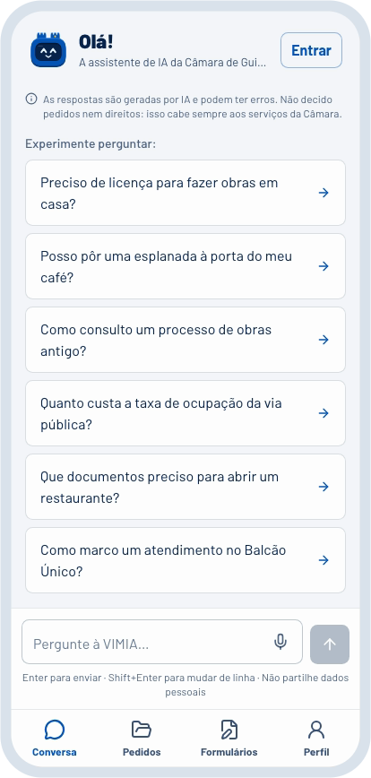

  <picture>
    <source media="(prefers-color-scheme: dark)" srcset="assets/vimia-escuro.svg">
    
  </picture>

  <b>Olá! Sou a VIMIA, a agente digital dos cidadãos de Guimarães.</b> 
  Diga-me o que precisa de tratar com a Câmara. Eu encontro o caminho e preparo o formulário consigo.

  <a href="https://vimia.cidadeberco.com/assistente"><b>Falar com a VIMIA</b></a>
  &nbsp;·&nbsp;
  <a href="https://vimia.cidadeberco.com/app">Abrir a app</a>
  &nbsp;·&nbsp;
  <a href="https://vimia.cidadeberco.com/vimia/business">VIMIA Empresas</a>
  &nbsp;·&nbsp;
  <a href="https://taikai.network/cmguimaraes/hackathons/hack4guimaraes2035/projects/cmvjxzu7000dfhlplxlcyyrcz/idea">Candidatura</a>

 

A informação para tratar de um assunto com a Câmara existe, mas está espalhada por páginas de serviços, regulamentos, tabelas de taxas e formulários escritos para quem já conhece os procedimentos. A VIMIA leu tudo isso para que mais ninguém tenha de o fazer.

<picture>
  <source media="(prefers-color-scheme: dark)" srcset="assets/numeros-escuro.svg">
  
</picture>

###  &nbsp;Comece pelo que precisa de fazer

> A minha casa ainda não tem número de porta. Como peço um?

Ninguém precisa de saber o nome do procedimento. A VIMIA percebe o pedido em palavras do dia a dia, encontra o percurso certo e acompanha a pessoa até ao fim. A seguir pode perguntar «que documentos tenho de juntar?» ou pedir «prepara-me o formulário».

A conversa guarda o contexto, por isso nada tem de ser explicado duas vezes.

###  &nbsp;Da conversa ao formulário

Vai organizar uma festa com música ao vivo? O dia, o horário e o local que contou à VIMIA passam diretamente para o requerimento. Cada campo pode ser revisto e corrigido antes de descarregar o PDF, com o aspeto do impresso oficial da Câmara.

Hoje a VIMIA já prepara a **licença especial de ruído**, o **horário especial de funcionamento**, a **atribuição de número de porta** e as **petições diversas**. A pessoa revê, assina e entrega.

###  &nbsp;Com a fonte à vista

Cada resposta indica onde foi buscar a informação, com ligação para o documento oficial. Para quem não sabe por onde começar, o guia **«Que licença preciso?»** faz meia dúzia de perguntas e aponta o caminho.

A VIMIA apresenta-se como inteligência artificial desde a primeira mensagem e só pede dados pessoais quando são precisos para um documento. Informa e prepara. A decisão fica sempre com os serviços municipais.

 

###  &nbsp;VIMIA Empresas

As empresas já trabalham com o ChatGPT, o Copilot, o Gemini ou o Claude. Com o primeiro servidor MCP municipal do país, esses agentes passam a tratar dos pedidos à Câmara a partir dos sistemas da própria empresa: identificam o procedimento, juntam os documentos e preparam o pedido. Uma pessoa só tem de confirmar.

Menos burocracia, mais razões para instalar a sede em Guimarães.

###  &nbsp;Feita em Guimarães

As duas torres que usa na cabeça vêm do Castelo. Fala português de Portugal, explica cada termo administrativo quando ele aparece e pode ser instalada no ecrã principal do telemóvel como qualquer outra app.

Por dentro, funciona com diferentes modelos de linguagem e está preparada para receber o **AMÁLIA**, o modelo português, a correr em infraestrutura própria.

###  &nbsp;Para onde vamos

O próximo passo é um piloto com cidadãos e técnicos municipais. Com a Câmara, queremos ligar a Chave Móvel Digital, submeter pedidos e acompanhar processos sem sair da conversa.

Queremos que, em Guimarães, tratar de um assunto com a Câmara comece sempre da mesma forma: **«preciso de tratar disto»**.

   
  <a href="https://vimia.cidadeberco.com/assistente"><b>Conheça a VIMIA →</b></a>
    

###  &nbsp;A equipa

Somos a [AIO Studio](https://aiostudio.xyz), um estúdio digital de Guimarães, e vamos continuar a VIMIA depois do hackathon.

<picture>
  <source media="(prefers-color-scheme: dark)" srcset="assets/equipa-escuro.svg">
  
</picture>

  <a href="https://github.com/MrNameless10">Miguel</a> &nbsp;·&nbsp;
  <a href="https://github.com/SimaoQuintela">Simão</a> &nbsp;·&nbsp;
  <a href="https://github.com/vitorribeiro99">Vítor</a>

 

<picture>
  <source media="(prefers-color-scheme: dark)" srcset="assets/parceiros-escuro.svg">
  
</picture>
