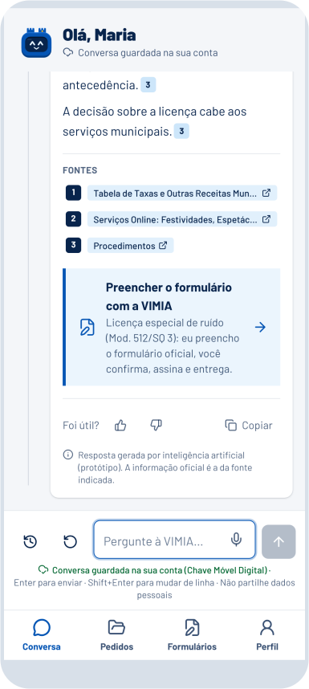

  <picture>
    <source media="(prefers-color-scheme: dark)" srcset="assets/vimia-escuro.svg">
    
  </picture>

  <b>Olá! Sou a VIMIA, a agente digital dos cidadãos de Guimarães.</b> 
  Diga-me o que precisa de tratar com a Câmara. Eu encontro o caminho e preparo o formulário consigo.

  <a href="https://vimia.cidadeberco.com/assistente"><b>Falar com a VIMIA</b></a>
  &nbsp;·&nbsp;
  <a href="https://vimia.cidadeberco.com/app">Abrir a app</a>
  &nbsp;·&nbsp;
  <a href="https://taikai.network/cmguimaraes/hackathons/hack4guimaraes2035/projects/cmvjxzu7000dfhlplxlcyyrcz/idea">Ver a candidatura</a>

 

###  &nbsp;Comece pelo que precisa de fazer

> A minha casa ainda não tem número de porta. Como peço um?

Ninguém precisa de saber o nome do procedimento. A VIMIA percebe o pedido em palavras do dia a dia, encontra o percurso certo e acompanha a pessoa até ao fim. A seguir pode perguntar «que documentos tenho de juntar?» ou pedir «prepara-me o formulário».

A conversa guarda o contexto, por isso nada tem de ser explicado duas vezes.

###  &nbsp;Da conversa ao formulário

Vai organizar uma festa com música ao vivo? O dia, o horário e o local que contou à VIMIA passam diretamente para o requerimento. Cada campo mostra de onde veio a informação e pode ser corrigido antes de descarregar o PDF, com o aspeto do impresso oficial da Câmara.

Hoje a VIMIA já prepara a **licença especial de ruído**, o **horário especial de funcionamento**, a **atribuição de número de porta** e as **petições diversas**. A pessoa revê, assina e entrega.

###  &nbsp;Com a fonte à vista

Cada resposta indica onde foi buscar a informação, com ligação direta para o documento municipal. Por trás estão **54 procedimentos** organizados a partir de fontes oficiais.

Para quem não sabe por onde começar, o guia **«Que licença preciso?»** faz meia dúzia de perguntas sobre obras em casa, restauração ou ocupação da via pública e aponta o caminho.

 

###  &nbsp;Feita em Guimarães

A VIMIA vive no portal e no telemóvel, e pode ser instalada no ecrã principal como qualquer outra app. Lá ficam as conversas, os formulários e o acompanhamento dos pedidos.

As duas torres que usa na cabeça vêm do Castelo. Fala português de Portugal e explica cada termo administrativo quando ele aparece, sem obrigar ninguém a decifrar o «juridiquês».

###  &nbsp;Para onde vamos

O próximo passo é um piloto com cidadãos e técnicos municipais, para medir quanto tempo a VIMIA poupa e perceber onde as pessoas ainda ficam presas.

Com a Câmara, queremos ligar a Chave Móvel Digital, submeter pedidos e acompanhar processos sem sair da conversa. Para as empresas, propomos uma ligação por MCP, para que os seus próprios agentes de IA tratem destes assuntos a partir dos sistemas que já usam.

Queremos que, em Guimarães, tratar de um assunto com a Câmara comece sempre da mesma forma: **«preciso de tratar disto»**.

 

  <a href="https://vimia.cidadeberco.com/assistente"><b>Conheça a VIMIA →</b></a>

 

<picture>
  <source media="(prefers-color-scheme: dark)" srcset="assets/parceiros-escuro.svg">
  
</picture>

[AIO Studio](https://aiostudio.xyz) é [Miguel Freitas](https://taikai.network/mrnameless10), [Simão Quintela](https://taikai.network/squintela24) e [Vítor Ribeiro](https://taikai.network/vitor933). Desafio «Falar com a Câmara sem Burocracia».
